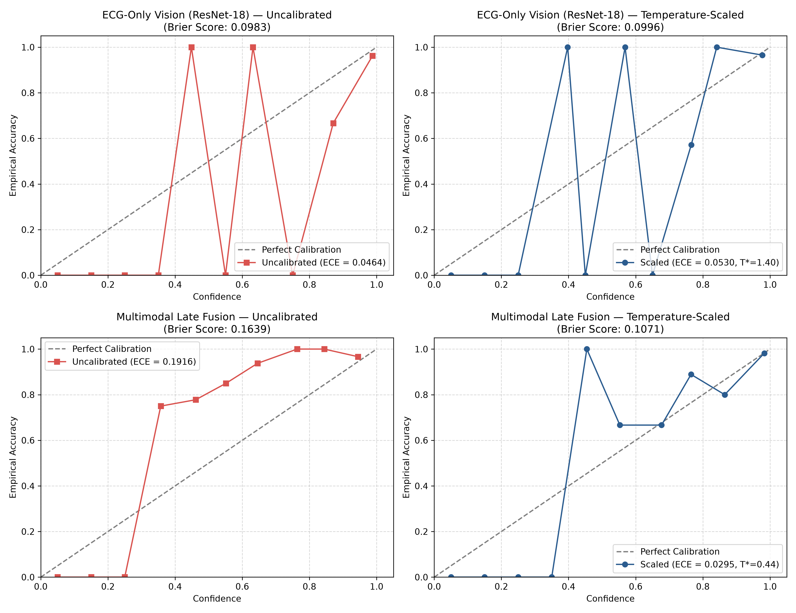

# Step 7: Probability Calibration & Reliability Assessment Report

**Optimization Technique**: Temperature Scaling ($z / T^*$) fitted strictly on validation partition logits
**Persisted Runtime Config**: `models\calibration_config.json`

## ECG-Only Vision (ResNet-18)
- **Fitted Optimal Temperature ($T^*$)**: `1.4035`
- **Recommended Inference Temperature**: `1.0000` (raw uncalibrated logits already achieve lower ECE; retaining `T = 1.0000` at inference)

| Calibration Metric | Raw Uncalibrated | Post-Temperature Scaling | Relative Improvement |
| :--- | :--- | :--- | :--- |
| **Expected Calibration Error (ECE)** | 0.0464 | **0.0530** | -14.2% |
| **Multiclass Brier Score** | 0.0983 | **0.0996** | -1.3% |

## Multimodal Late Fusion
- **Fitted Optimal Temperature ($T^*$)**: `0.4378`
- **Recommended Inference Temperature**: `0.4378` (temperature scaling improves validation ECE)

| Calibration Metric | Raw Uncalibrated | Post-Temperature Scaling | Relative Improvement |
| :--- | :--- | :--- | :--- |
| **Expected Calibration Error (ECE)** | 0.1916 | **0.0295** | +84.6% |
| **Multiclass Brier Score** | 0.1639 | **0.1071** | +34.7% |

## Clinical Importance of Probability Calibration
- Deep neural networks equipped with cross-entropy and modern optimizers can be miscalibrated on borderline diagnostic scans (for example, Multimodal Late Fusion starts underconfident with ECE `0.1916`, which temperature scaling sharpens to `0.0295`).
- Temperature scaling rescales logit dispersion without altering the argmax diagnostic prediction, and validating calibration per model ensures scaling is only applied when it improves empirical reliability.

## Reliability Diagram Exhibit

